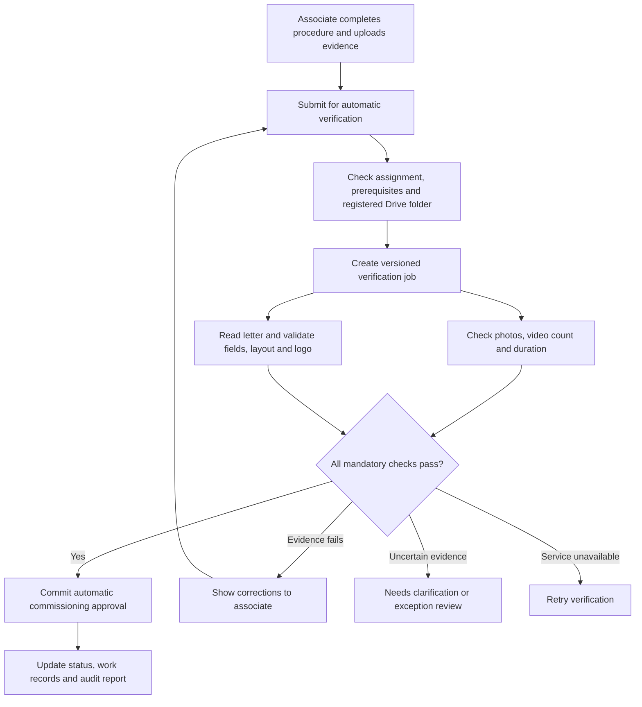

# Automatic commissioning verification from Google Drive

Status: Discussion and design proposal only. No application implementation or database changes are included.

Prepared: 16 November 2026.

Updated scope: apply only to eligible NEW commissioning requests after an explicit future activation time. Preserve existing commissioning/submission history. Use a self-hosted, open-source verifier to avoid paid OCR/cloud processing services. These requirements take precedence over earlier optional technology suggestions in this document.

Implementation update: the user has now authorized implementation and specified 4–5 photos and 4–5 video clips, with an average video duration of at least two minutes. The implemented minimum is 4 unique readable photos and 4 unique readable video clips; extra files are allowed. The arithmetic mean across qualifying clips must be at least 120 seconds. This supersedes all earlier per-video-minimum planning assumptions and pending quantity questions below. Implementation/setup details and remaining certificate requirements are in [the verifier README](../integrations/commissioning-verifier/README.md). The migration and automatic approval remain undeployed and disabled pending real Drive access, certificate policies and validation.

Confirmed folder layout: company name identifies the company root under an approved parent Drive folder. Discover media inside it automatically. Find the completed letter either in a commissioning-letter/certificate folder (including common spelling variants) or directly in the company root. Separate photo/video/certificate folder mappings are not required. Duplicate company-name matches or multiple final-letter candidates block automatic approval rather than selecting arbitrarily.

Latest deployment update: the two commissioning migrations and read-only Drive-check Edge Function were deployed on 16 November 2026. Existing business records were verified unchanged. Automatic commissioning remains disabled. See [the current UI setup handoff](COMMISSIONING_UI_SETUP.md) for the remaining Google settings; this supersedes earlier undeployed status statements below.

## A. Protect all existing records and dates

**Existing commissioned and submitted companies/sites must be excluded from this automation.** Do not rescan, reapprove, backfill, reset, or recalculate their records. Preserve their commissioned dates, submitted dates, work dates, approval history, progress, earnings and paid records.

“New” means a new eligible commissioning request, not necessarily a newly created company. A company that has been in the application for months can qualify if its site has not already been commissioned/submitted and its first commissioning request starts after activation.

Define an explicit activation timestamp when implementation is ready. This discussion date does not activate anything. Store the timestamp consistently in UTC and display it in India time when needed.

Proposed routing rules:

| Situation at activation | Treatment |
| --- | --- |
| Already commissioned, approved, commissioning-submitted, or in a later submitted/certification stage | Excluded permanently from this rollout; preserve history |
| Existing pending or rejected commissioning request | Keep the existing process; do not silently move it into automation |
| No commissioning request yet, not previously commissioned/submitted, and first request created after activation | Eligible for automatic verification |
| Older company record but otherwise meets the previous row | Eligible; company creation date is not the criterion |
| Repeated verification of a new eligible request | Same automation cohort, new attempt; preserve first request identity |

Use an immutable eligibility/cohort decision and original first-request timestamp. The current request function updates `requested_at` on resubmission, so filtering only on its latest value would incorrectly classify an old resubmission as new. A previously commissioned site must not become eligible because somebody later edits its status backwards. Check historical completion indicators and the exclusion decision too.

At launch, record the excluded existing sites/requests without rewriting their business fields. Enforce eligibility both when creating a verification job and immediately before committing an approval. The worker must not have an unrestricted “update all commissioned sites” task.

For eligible new requests, the finalizer writes only the current site's required commissioning/approval records. Existing nonempty business dates must not be overwritten. Store verification time separately from actual work time and any later submission date. If inconsistent existing data makes the correct date unclear, stop that attempt for clarification instead of repairing history automatically.

Scope “submitted” carefully: prior submission of assessment or installation is a prerequisite and must remain intact; it does not by itself mean that commissioning has already been submitted. Prior commissioning completion or a later company Submitted stage excludes that site.

Before rollout, compare historical records before and after a trial approval. Required acceptance condition: no changes to excluded sites' dates, statuses, progress, approval records or financial records. Monitor this during the controlled rollout. This is a design requirement, not a claim that an unimplemented change has already been tested.

## B. Can the system access Google Drive directly?

**Yes: the backend connects directly to Google Drive through the Google Drive API.** A manager does not need to open Drive for every request. This is authenticated API access, not automation that logs into the manager's browser and clicks through folders.

The setup is:

1. Register the exact company/site folder IDs in the application.
2. Enable the Drive API in a Google Cloud project.
3. Choose a dedicated service account, where your sharing policy permits it, or connect an organization-controlled Google account through OAuth.
4. Grant that identity read access to the approved folders, including permission to download required files. Public sharing is unnecessary.
5. Keep the credentials only on the backend verifier.
6. On an eligible request, list the mapped folder's files and read their metadata. Temporarily download images, letters and videos only as needed for inspection.
7. Save the verification report in the application and delete temporary processing copies under the retention policy.

A folder URL identifies the folder; it does not grant the verifier access. The service can only inspect files accessible to its Google identity. Revoked access should produce a technical error, never an automatic pass. The initial design uses read-only Drive access, so it does not move, edit or delete your original evidence.

## C. Recommended flow with no paid verification services

```text
Associate uploads evidence to the existing mapped Drive folder
  -> Application checks NEW-request eligibility
  -> Eligible request enters a durable verification queue
  -> Worker on your existing computer/server claims the job
  -> Drive API lists files and provides metadata/downloads
  -> Local image checks count valid unique photographs
  -> Drive video metadata / local ffprobe checks duration
  -> Local Tesseract OCR reads the commissioning letter
  -> Rules match company, required text, dates and entered details
  -> Local visual checks compare the approved logo/letterhead
  -> All mandatory checks pass: authorized server finalizer approves
  -> Missing/unclear evidence: corrections required, no approval
```

An outbound-polling worker is a practical option: it checks the application's queue periodically and connects outward to Drive and the application backend. It does not need a public port on your office computer. Job claiming, result submission and approval still require restricted backend authentication. Keep privileged credentials out of the associate's browser.

### Free software and service choices

| Task | Proposed tool | Cost qualification |
| --- | --- | --- |
| Drive listing/metadata/download requests | Google Drive API | Standard usage has no additional API charge; quotas and existing storage/account limits still apply |
| Read printed certificate text | Local Tesseract OCR | Open-source software, no per-page OCR service fee |
| Video duration | Drive metadata, with local FFmpeg/ffprobe fallback | No paid video-analysis API required |
| Image decoding and logo comparison | Local OpenCV and rule-based matching | No paid vision-model API required |
| Text/date/company checks | Local application rules | No language-model API required |
| Background processing | Existing available PC or server | No new hosting subscription if that machine already has spare capacity |
| Queue, report and status | Existing application/database | Uses existing capacity; plan quotas, storage and network limits still apply |

Google states that standard Drive API use has no additional cost in its [usage limits documentation](https://developers.google.com/workspace/drive/api/guides/limits). [Tesseract](https://tesseract-ocr.github.io/tessdoc/) is open source under Apache 2.0. [ffprobe](https://ffmpeg.org/ffprobe.html) provides machine-readable media information. OpenCV documents [feature matching for locating known objects](https://docs.opencv.org/4.x/d1/de0/tutorial_py_feature_homography.html); adapting this to your logos would require sample-based testing, not an assumption of perfect logo verification.

**Meaning of free here:** no paid OCR, AI, or new cloud hosting subscription for verification. There are still electricity, internet, maintenance and existing infrastructure costs. A new dedicated server, extra Drive storage, or an exceeded existing database/network allowance may cost money. If you already have a suitable running machine and enough existing capacity, this can avoid additional recurring verification-service charges.

Do not choose Google Document AI or paid vision APIs for this version. Do not rely on cloud trial credits as a permanent free solution. Google Cloud's Free Tier requires a billing account and has usage limits; see its [Free Program documentation](https://docs.cloud.google.com/free/docs/free-cloud-features). Cloud Run was mentioned earlier as an option, but it is not the default under your no-paid-service requirement.

### What happens if the computer is switched off?

Jobs stay queued and resume when the worker returns. They must never autoapprove just because a timeout expires. A laptop is enough for a pilot, but continuous operation needs a machine that stays powered on and connected. If no suitable machine is available, zero-cost, always-on processing cannot be promised.

### Limits of a free OCR and visual-check approach

- Clean typed letters in a known format are the best starting point. Handwriting, stamps over text, blur and low contrast can produce uncertain OCR results.
- Logo matching needs approved reference artwork per company and can fail on poor scans or changed letterheads. An uncertain match must block approval or use your agreed exception process.
- Signature/authority verification remains limited to defined presence checks and trusted name/role comparisons. Free OCR does not authenticate a signer.
- Photo count and video length checks do not prove that the machine is correctly commissioned. Broader content judgment needs its own validated solution and computing capacity.

To make the free version practical, standardize the final certificate format, request clear scans, maintain company names/aliases and logo references, and return precise correction messages when the verifier is uncertain.

### Example of historical protection

Suppose Site A was commissioned and later submitted before activation. It is excluded: no dates, statuses or earnings change, even if files are later added to its Drive folder.

Site B already exists but has never been commissioned/submitted and has no prior commissioning request. Its first request after activation can use the new verification flow. When it passes, record its approval and verification results while preserving earlier assessment/installation records and business dates.

Site C has a pending commissioning request from before activation. It remains in the old process. Resubmitting it after activation must not silently reclassify it as new.

## 1. What you want to achieve

Currently, a field associate finishes the commissioning procedure, submits a Google Drive link, and requests approval. A manager opens the folder, checks the photographs, videos, and commissioning letter, then approves the company/site as commissioned.

The proposed flow replaces that routine manager check with an automatic verification service:

1. The associate completes the commissioning procedure and uploads the evidence.
2. The associate submits the commissioning request.
3. The system opens the registered Drive folder for that exact company and site.
4. It checks the required number of valid photographs and videos.
5. It verifies the video duration against the two-minute rule.
6. It reads the completed commissioning letter and checks its required details and visual elements.
7. If every mandatory check passes, the system automatically approves commissioning and updates the application.
8. If something is missing, it tells the associate exactly what to fix. An unavailable service or unreadable scan must never produce automatic approval.

**This is feasible.** Reliable automation requires a defined checklist, trusted company-to-folder mapping, approved certificate references, and a backend verification service. A Drive link and an OCR scanner alone are not enough.

The minimum photo count, minimum video count, actual Drive paths, and final certificate requirements are still pending from you. They are deliberately not assumed here.

## 2. What the existing application already provides

The following observations come from the local repository, not an inspection of the deployed database:

| Existing component | Relevant behavior |
| --- | --- |
| `src/components/business-consultant/CommissioningTab.tsx` | Generates the certificate, takes a Drive link, submits a request, and provides manager approval actions. The current associate flow requires downloading the Word certificate before requesting approval. |
| `submit_commissioning_approval_request` | Creates or updates a pending request for the site, with access checks. |
| `review_commissioning_approval_request` | Checks manager authorization, approves/rejects the request, and marks commissioning submitted on approval. |
| `prevent_unapproved_commissioning_submission` | Guards the final commissioning submission marker. |
| `src/utils/status.ts` | Uses commissioning completion information when deriving site status. |
| Field operations migrations | Connect commissioning readiness, manager confirmations, work dates, and earnings eligibility. |

The current generated letter includes the company name, date, NPC addressee, SIM Kit commissioning statements, and signatory/seal labels. These are useful starting references, but a downloaded blank template is not evidence of a completed, signed letter. The actual uploaded certificate must be checked.

One important integration detail: some manager-confirmation logic explicitly requires a signed-in staff user. A background worker does not automatically satisfy that requirement. The future automation must deliberately support a trusted system approval actor and update the required business records through an authorized server operation.

## 3. Proposed end-to-end flow



Routine valid submissions would no longer wait for manager approval. An optional exception queue can handle cases the system cannot confidently assess. If you want absolutely no manager review, uncertain cases must remain unapproved until the associate supplies clearer evidence or an administrator corrects the configuration. The system must not guess.

## 4. Identifying the correct company folder

### Store folder IDs against the company/site

The system should store a mapping such as:

| Application record | Registered Drive information |
| --- | --- |
| Company ID and site ID | Exact approved evidence folder ID |
| Commissioning attempt | Attempt folder or explicit evidence file selection |
| Photo location | Registered photo subfolder ID, if used |
| Video location | Registered video subfolder ID, if used |
| Certificate location | Registered certificate subfolder ID, if used |

Use the application's IDs as the main identity. Company folder names are display information: names can repeat or change, and one company may have several sites. Never search only by company name and approve the first match.

When you provide the actual structure, we can adapt to it. An example structure, not a required migration, is:

```text
Approved commissioning root/
  Company ID - Company name/
    Site ID/
      Attempt ID/
        Photos/
        Videos/
        Commissioning Letter/
```

For an existing flat folder, the alternative is to register the relevant file IDs for each submission. This prevents old site evidence or an old letter from being counted again unintentionally.

If the associate still pastes a link, the backend must verify it against the stored mapping. A valid Google Drive URL by itself does not prove the evidence belongs to this site.

### List and scope the files correctly

The Drive API can list direct children with a parent-folder filter and exclude trashed files. Nested folders require explicit traversal; a parent query does not recursively list every descendant. Every result page must be fetched before deciding that evidence is missing. Shared Drive searches require the relevant Shared Drive parameters. See Google's [file search guide](https://developers.google.com/workspace/drive/api/guides/search-files), [files.list reference](https://developers.google.com/workspace/drive/api/reference/rest/v3/files/list), and [Shared Drive support guide](https://developers.google.com/workspace/drive/api/guides/enable-shareddrives).

Recommended policy: count only evidence inside the registered attempt scope. Reject shortcuts initially, or resolve and validate their target location explicitly. Do not let a shortcut pull unrelated evidence into the count.

## 5. Connecting Google Drive

The verifier needs an authenticated Google identity that can read the registered folders and download the evidence. A manager being able to open a link in their browser does not grant the backend access. Google checks the requesting identity's permissions; see [Drive sharing and access control](https://developers.google.com/workspace/drive/api/guides/manage-sharing).

Two possible setups:

| Setup | How it would work |
| --- | --- |
| Dedicated service account | Share the approved folders with the service account where Workspace policy permits it. The backend reads using that identity. |
| Organization-controlled Google account using OAuth | An authorized account connects Drive; the backend securely manages its refresh credentials. Suitable when service-account sharing is restricted. |

Prefer read-only Drive access for verification. Credentials belong in server secret storage, never in browser code or the database fields visible to associates. Folder access must also permit downloading files for OCR/media inspection. Domain sharing rules and restricted child folders must be tested during setup.

Setup would include a Google Cloud project for Drive API access, local OCR/media tools on the existing processing machine, and access to a small test evidence folder. Do not enable paid OCR or billing-dependent processing for the proposed free version. None of these connections or settings have been changed for this proposal.

## 6. Photo checks

You will define the minimum count and whether specific categories are required. Categories might include installed equipment, machine connection, dashboard, and completed installation, but these are examples only.

Proposed validation sequence:

1. Read files only from the approved photo location for this attempt.
2. Check the media type and decode the file to confirm it is a readable image. Renaming a document to `.jpg` must not make it qualify.
3. Exclude empty, corrupted, and unsupported files.
4. Exclude the letter scan and unrelated image assets from the photo count.
5. Count unique qualifying photographs. Content hashes can identify exact copies; detecting cropped or recompressed duplicates requires an additional similarity check.
6. Compare the result with your configured minimum and any category rules.

There is a difference between **having enough image files** and **showing the required installation evidence**. If you want the system to replace the manager's visual judgment too, we need a checklist of what each photograph must show and a separately validated visual model. Counting alone cannot confirm that the installation is correct or that a photograph was taken at this company.

Any proposed blur, resolution, category, or relevance threshold must be calibrated on your actual examples before it becomes an approval rule.

## 7. Video count and the two-minute rule

The duration requirement needs one clarification before implementation: does two minutes mean a minimum of 120 seconds, an exact target with an allowed tolerance, or a maximum of 120 seconds?

**Planning assumption only:** each required qualifying video must be at least 120 seconds. Do not activate this assumption until you confirm it. Also confirm whether the minimum count applies to individually qualifying videos or whether every submitted video must qualify. Combining several short clips into two minutes should not pass unless you explicitly allow combined duration.

Proposed verification:

1. Count unique readable videos in the registered video location.
2. Obtain the duration for each video.
3. Compare unrounded duration with the agreed rule.
4. Confirm there are enough videos that satisfy the rule.
5. Report each failing file and its measured duration.

Drive exposes `videoMediaMetadata.durationMillis` when available, documented in the [Drive file resource](https://developers.google.com/workspace/drive/api/reference/rest/v3/files). If metadata is unavailable, retry while Drive finishes processing or inspect the downloaded video with a server-side media parser such as `ffprobe`. Do not treat missing duration as a pass. File extensions and filenames such as `2min_video.mp4` are not evidence of duration.

Under the proposed minimum rule, 119.8 seconds fails and 120.0 seconds passes unless you explicitly approve a tolerance. Two 60-second videos would not replace one required two-minute video.

Duration checks do not establish that the video shows the correct operating machine. If required, define scene/content checks separately. Sampled frames cannot prove that the entire video contains valid content or detect every repeated/static segment.

## 8. Commissioning letter verification

### A. Select the final completed letter

Use the uploaded completed certificate, preferably a readable PDF or supported scan. Decide whether multiple letters are allowed and which one is authoritative. If the system finds several conflicting candidates, request clarification rather than selecting whichever happens to pass.

For Word uploads, use a controlled parser or render to a consistent PDF/image representation before visual validation. Never execute document macros. The accepted formats, file sizes, and page limits should be defined explicitly.

### B. Read text and layout

A local OCR engine converts scanned text into structured text with locations on the page. Under the updated free-service requirement, use Tesseract first and test its suitability and confidence thresholds on your real scans and languages. Google Document AI, mentioned in the initial discussion, is not part of the proposed free setup.

Digital PDFs can also provide native text, but a hidden text layer should not override conflicting visible content. Render the pages when validating appearance.

### C. Compare extracted fields with trusted records

The following is a proposed checklist for you to confirm:

| Item | Proposed validation | Input needed |
| --- | --- | --- |
| Company name | Match the site's registered company name or an explicitly approved alias | Official names and aliases |
| Site/address | Match the relevant site, especially for companies with multiple locations | Required address fields |
| Certificate heading | Identify an approved installation/commissioning certificate type | Accepted headings/templates |
| Commissioning declaration | Require the agreed statement that installation and commissioning are complete | Mandatory wording or accepted variants |
| Date | Read a valid date and apply your allowed date window | Date policy and work-date rules |
| Device/machine reference | Match the installed kit or machine if required | Required identifiers |
| Addressee/project | Check NPC/project details where required | Mandatory details |
| Authorized person's name | Require an actual entered name, not just the printed `Name:` label | Whether required; approved names if available |
| Designation | Require an entered designation and apply any approved-role list | Accepted authority roles |
| Logo/letterhead | Compare visible artwork with approved company references | Reference logo/letterhead per company |
| Signature and seal | Check visible presence if required | Presence requirements and accepted examples |

Normalize harmless spacing, capitalization, and punctuation. Do not silently equate different legal entities using broad fuzzy matching. Missing or unreadable mandatory fields must prevent automatic approval.

### D. Check logo and format visually

OCR reads text; it does not reliably verify that an image is the correct company logo. Use a separate visual comparison against approved logo/letterhead references. It should account for scanning, scaling, and rotation while rejecting a wrong or missing logo. A generic logo detector or company name printed near the top is insufficient.

Define what “format matches” means: required sections, approved template family, and placement of key elements, or an exact layout. Multiple company letterheads may need separate approved references. The system cannot validate an unknown logo without a trusted reference.

### E. Understand authority and authenticity limits

The printed words `Authorized Signatory`, a visible signature, or a company seal do not prove that the person is authorized. The automation can check presence and compare a name/designation with an approved list if one exists. It cannot establish identity or detect every forged signature from OCR alone.

If verified authority is mandatory, use an approved signatory registry, company confirmation, or a separately validated digital-signature process. Decide whether your business requirement is visible completion of the letter or independent authentication of the signer.

## 9. Approval decisions and associate messages

Approval should use mandatory pass/fail checks, with uncertainty handled separately. A high overall score must never compensate for the wrong company name, missing required video, or absent mandatory signature.

| Result | System action | Example associate message |
| --- | --- | --- |
| Every mandatory check passes | Automatically mark commissioned | “Verification passed. This site is commissioned.” |
| Evidence is incomplete or fails a rule | Keep unapproved; allow correction and resubmission | “One required video is too short: 01:42. Upload a qualifying video.” |
| Certificate is unclear | Request a clearer scan or use the agreed exception process | “The signatory name could not be read. Upload a clearer certificate.” |
| Wrong company or folder | Block approval | “The certificate company does not match this site.” |
| Access denied or provider outage | Record technical issue and retry where appropriate | “Verification could not access the evidence folder. Check sharing permissions.” |

Recommended verification states: `queued`, `checking`, `passed`, `needs_correction`, `needs_review`, and `technical_error`. These are proposed verification states; the existing approval table currently uses its own approval statuses. Keep the verification report separate or deliberately migrate those constraints later.

For the initial flow, trigger verification when the associate submits or resubmits. This gives a clear evidence boundary. Automatic Drive-change monitoring can be added later if you want it; it should not silently commission a site merely because a file appeared in Drive.

## 10. Backend architecture

```text
Existing application
  -> Authorized submission endpoint
  -> Durable verification job in database/queue
  -> Background worker
       -> Google Drive inventory and scoped downloads
       -> Photo and video validation
       -> OCR and visual certificate checks
       -> Rules evaluation and evidence report
  -> Trusted server-side commissioning finalizer
  -> Updated application status and notifications
```

For this project, keep Supabase as the application database and approval authority. A server endpoint or Edge Function can validate the submission and queue work within existing plan capacity. Run heavier downloads, document rendering, OCR and media parsing on an existing suitable PC/server to avoid a new hosting subscription. Confirm available capacity and file sizes before selecting that machine.

Do not keep the associate's browser waiting for all processing or depend on that browser remaining open. The application should display progress and retrieve the saved result later.

A proposed data design would contain:

| Record | Purpose |
| --- | --- |
| Evidence folder mapping | Company/site IDs and approved Drive locations |
| Versioned rule set | Counts, duration interpretation, letter requirements and reference versions |
| Verification attempt | Request revision, associate, state, timestamps, retries and rule version |
| File evidence manifest | File IDs, types, sizes, versions/hashes and measured properties |
| Check results | Pass/fail/uncertain per rule, extracted values and source page/file |
| Approval audit | Human/system actor type, attempt ID, decision time and any override reason |

These are conceptual records, not schema changes made by this document.

## 11. Updating commissioning safely

When a job passes, a trusted backend operation should validate and commit the approval. It must:

1. Confirm the attempt still belongs to the current request revision and registered site.
2. Confirm all required checks passed under the pinned rule version.
3. Revalidate the evidence manifest before committing; changed, moved, or replaced evidence requires a fresh check.
4. Create or update the commissioning record if necessary and persist completion server-side.
5. Update the request decision, completion marker, relevant site status and audit record consistently.
6. Reconcile work-date and earnings eligibility through the established field operations rules exactly once.
7. Record the system as the approval source, with the successful verification attempt ID.

Do not call the current manager RPC from the browser using elevated credentials, impersonate a manager, or weaken the existing approval guard for all users. A future service-only finalizer needs explicit authorization, restricted execution grants, and compatibility with the existing triggers.

The current UI has a repair path for previously approved requests whose commissioning data was not fully saved. Automatic approval should finish independently on the server, including when no user opens the commissioning page afterward.

Existing earnings integrations must be reviewed end to end during implementation. A service-role write alone does not guarantee that staff-only triggers will run as intended. Approval must not create a duplicate earning, change an already-paid earning, or make a payment automatically unless a separate payment workflow explicitly authorizes that action.

Keep these dates distinct: actual work date, request time, verification completion time, and approval time. Use the established work-date policy rather than treating a delayed OCR result as the date the associate performed the work.

## 12. Retries, changing files, and auditability

- Use one current request revision and separate immutable attempt history. A result from an older attempt must not approve a newer submission.
- Persist jobs durably and use bounded retries for transient Drive/OCR errors. Missing business evidence requires correction, not endless retries.
- Make finalization idempotent: repeated worker delivery must produce one approval and one eligible earning.
- Store the evidence manifest and relevant OCR/visual results so a later dispute can be traced to what was checked.
- Pin the rule version and reference template/logo version used for each attempt.
- Treat document text as untrusted data. If a visual AI model is used, instructions inside uploaded documents must not control tools or approval decisions.
- Limit download sizes, processing time, supported file types and temporary-file retention. Delete temporary copies according to a defined retention policy.

Drive evidence can change after approval. Decide whether the approved evidence must be preserved as a controlled snapshot, or whether later changes should trigger an alert/reverification. A stored link alone is not an immutable audit record. Rechecking just before approval reduces races but does not lock Drive files permanently.

## 13. What must be provided before implementation

| Required input | Why it matters |
| --- | --- |
| Root Drive link and representative company/site folder paths | Establish exact folder mapping and traversal rules |
| Whether this is My Drive or a Shared Drive | Select authentication and search configuration |
| Minimum photo count and required photo categories | Define photo pass/fail rules |
| Minimum video count | Define how many qualifying videos are needed |
| Meaning of “two minutes” | Minimum/exact/maximum, tolerance, and per-video versus combined duration |
| Approved completed certificate examples and blank template | Define accepted format and required content |
| Correct logo/letterhead references | Make visual matching possible |
| Final list of required letter fields | Separate mandatory fields from optional information |
| Signatory authority policy | Define presence checks versus actual authority verification |
| Accepted file formats and languages | Select OCR/parsing and conversion paths |
| Old evidence reuse and resubmission rules | Prevent unrelated or stale files being counted |
| Exception policy | Decide what happens when evidence is uncertain |
| Approximate submissions per day and typical file sizes | Estimate hosting, processing time and cost |

Passwords or secret keys should not be included in this Markdown document. Access can be configured securely when implementation is authorized.

## 14. Suggested delivery stages after discussion

**Stage 1: Finalize rules and samples.** Review your Drive structure and representative valid/invalid submissions. Agree the minimum counts, duration rule, certificate fields, logo references and exception policy.

**Stage 2: Build a read-only verifier.** It produces a detailed report without changing commissioning status, scoped to test data and eligible new requests. Test photo counting, duplicates, video duration, certificate extraction and folder identity. Do not scan or backfill excluded historical sites.

**Stage 3: Run in comparison mode.** Compare system decisions with manager decisions on real submissions. Investigate both incorrect approvals and incorrect failures. Calibrate OCR and visual checks using held-out examples before enabling automatic decisions.

**Stage 4: Enable automatic approval for a controlled group of eligible new requests.** Record the activation timestamp and immutable exclusions. Add the trusted finalizer, audit trail, corrected associate messages, retry handling, and status/earnings reconciliation scoped to each new approval. Verify that excluded historical dates and records remain unchanged. Routine passing requests bypass the manager queue.

**Stage 5: Expand after review.** Monitor failure reasons, exception volume, processing time and cost. Keep an operational switch to stop new automatic approvals if a verifier problem appears; already approved records should not be silently reversed.

These stages describe future work only. No implementation is started by this proposal.

## 15. Minimum acceptance scenarios

| Scenario | Expected result |
| --- | --- |
| Correct scope, enough unique valid media, qualifying durations, correct completed letter | Commissioned automatically |
| Photo count below configured minimum | Needs correction |
| Same photograph uploaded under several names | Exact duplicates do not inflate the count |
| Letter scan stored alongside photographs | Does not inflate the photo count |
| Video just below agreed duration boundary | Apply the exact agreed boundary/tolerance |
| Duration metadata missing | Retry or inspect media; never approve using an assumption |
| Valid-looking folder belonging to another site | Block approval |
| Letter names another company | Block approval |
| Blank downloaded certificate with unfilled signatory fields | Fails required completion checks |
| Correct text with wrong/missing required logo | Fails logo rule or goes to uncertainty handling |
| Unreadable scan or unfamiliar letterhead | No automatic approval |
| Drive outage or access denied | Technical issue, with no commissioning change |
| Files change while being checked | Invalidate affected result and verify the new evidence |
| Associate resubmits while an old job is running | Old job cannot approve the new revision |
| Worker retries after successful approval | No duplicate completion or earning |
| Associate closes browser immediately after submission | Backend still completes the job |
| Existing commissioned/submitted site receives new Drive files | Excluded; no verification-driven changes |
| Pre-activation pending/rejected request is resubmitted | Remains outside the automatic rollout |
| New eligible site is approved | Preserve existing assessment/installation dates; record approval and verification dates separately |
| Historical snapshot compared before/after pilot | Excluded dates, statuses, approvals, progress and financial records unchanged |
| Local worker is offline | Jobs remain queued; no automatic approval or paid fallback |

## 16. Cost and expected timing

Under the updated plan, local open-source OCR/media/visual tools avoid per-page and per-request paid verification services. Standard Drive API use has no additional API charge, subject to quotas. Processing uses your existing machine, internet and application capacity. Extra storage, new hosting or excess existing-plan usage may still cost money; there is no unconditional zero-total-cost guarantee.

No fixed price or completion-time guarantee is appropriate until typical files and submission volume are known. Measure a representative batch first. Large videos, slow downloads, conversion, OCR queues and provider retries can all affect completion time. Cache unchanged evidence by content/version and run inexpensive checks first to reduce unnecessary processing.

## 17. Proposed result for your workflow

The associate continues the commissioning procedure and uploads evidence to the correct company/site folder. On submission, the system verifies your configured photo/video requirements and the completed letter. A complete, clearly matching submission becomes commissioned automatically. An incomplete submission receives specific correction instructions. Uncertain evidence and technical errors remain unapproved under the agreed handling policy.

The remaining design decisions are your quantities, exact two-minute rule, Drive folder mapping, accepted certificate/logo references, and authority requirements. Once those are defined, this proposal can be converted into an implementation specification.
